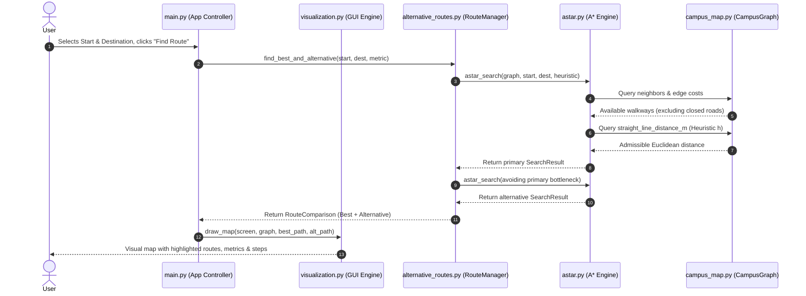

# Smart Campus Navigator — Project Instructions & Architecture Guide

**Course:** Fundamentals of AI (CF321) — Project 1: Search Algorithms  
**Faculty:** Faculty of Computers and Information Technology, Innovation University  
**Topic:** Informed Search & Pathfinding using Custom A* Algorithm on Weighted Campus Graph

---

## 1. Project Overview

**Smart Campus Navigator** is an interactive university desktop navigation application built in Python using Pygame. The software models a real-world university campus as a weighted, undirected graph, allowing students and visitors to select start and destination points, calculate optimal walking routes using a custom implementation of the **A* Search algorithm**, explore realistic alternative paths, simulate road maintenance closures, and seamlessly toggle between Light and Dark themes.

---

## 2. File Organization & Responsibilities

The codebase adheres strictly to clean separation of concerns:

```
smart-campus-navigator/
│
├── main.py                  # Desktop application entry point & interactive Pygame loop
├── campus_map.py            # Graph topology, building coordinates, walkways, and scale
├── astar.py                 # Pure Python custom A* search algorithm & heuristics
├── alternative_routes.py    # Creative Bonus: alternative path generator, closures, query history
├── visualization.py         # UI engine: Light/Dark themes, vector map renderer, widgets
├── tests.py                 # Automated unit test suite (11 test suites covering all rubric criteria)
├── requirements.txt         # External package dependencies (pygame>=2.5.0)
├── README.md                # Comprehensive project documentation & defense reference
└── PROJECT_INSTRUCTIONS.md  # Architectural overview and developer instructions (this file)
```

### Module Responsibilities

1. **`campus_map.py`**
   - Implements `CampusGraph`, `Location`, and `Walkway` data structures.
   - Represents 10 campus landmarks (Main Gate, Computer Science, Student Center, Sports Complex, Engineering, Library, Administration, Science Building, Cafeteria, Dormitory).
   - Manages bidirectional walkway connectivity, physical walking distances ($m$), effort cost ratings, and dynamic edge open/closed statuses.
   - Encapsulates Euclidean straight-line distance calculations calibrated with `CAMPUS_SCALE_METERS = 680.0` ensuring mathematical admissibility.

2. **`astar.py`**
   - Independent of graphical libraries; uses standard library `heapq`.
   - Implements $f(n) = g(n) + h(n)$ search logic.
   - Provides multiple heuristic functions:
     - `euclidean_distance_heuristic`: Straight-line Euclidean distance in meters ($h(n) \le h^*(n)$ guaranteed).
     - `euclidean_cost_heuristic`: Scaled cost rating heuristic.
     - `zero_heuristic`: $h(n) = 0$ turning A* into Dijkstra's Algorithm (Uniform-Cost Search) for baseline comparison.
     - `manhattan_heuristic`: Manhattan grid heuristic.
   - Returns a structured `SearchResult` encapsulating path sequence, physical distance, total cost, node expansion count, exploration order, and runtime execution duration in milliseconds.

3. **`alternative_routes.py`**
   - Implements `RouteManager` handling:
     - **Smart Alternative Route Discovery**: Identifies high-quality secondary routes by avoiding critical bottleneck segments of the primary path.
     - **Dynamic Road Closures**: Enables/disables specific graph edges, triggering instant A* rerouting.
     - **Session History**: Logs recent queries with timestamps, distances, and status for instant 1-click recall.

4. **`visualization.py`**
   - High-fidelity UI and rendering subsystem.
   - Stores WCAG-compliant color dictionaries for **Light Mode** (default) and **Dark Mode**.
   - Custom vector map drawing engine:
     - Lush lawns, trees, running tracks, scenic lake, central courtyard fountain.
     - 10 illustrated 3D-styled buildings with roofs, porticos, and department badge icons.
     - Animated/pulsing start pin (Green) and destination pin (Red).
     - Optimal path glowing polyline (Royal Blue) and alternative path (Dashed Purple).
     - Prominent closed road badges (Red 'X').
     - Compass Rose and legend.
   - Custom Pygame interactive widgets: `Button`, `Dropdown`, `Checkbox`, `draw_rounded_rect`, `draw_shadowed_card`.

5. **`main.py`**
   - Houses `SmartCampusNavigatorApp` controller.
   - Coordinates window events, mouse clicks, keyboard shortcuts, theme switches, and real-time state synchronization across all modules.

6. **`tests.py`**
   - Standalone test suite executing 11 automated verification tests:
     - Graph topology & symmetry
     - Straightforward pathfinding
     - Minimum-cost path selection
     - Strict heuristic admissibility across all pairs ($h(n) \le h^*(n)$)
     - Heuristic consistency & triangle inequality ($h(u) \le c(u, v) + h(v)$)
     - Search efficiency ($A^*$ vs Dijkstra node expansions)
     - Boundary cases (identical start/goal, disconnected destinations)
     - Road closure & detour rerouting
     - Road reopening & optimal path restoration
     - Alternative route validity and cost differences

---

## 3. How Components Interact (Execution Flow)



---

## 4. Key Developer Commands

### Launch Application
```bash
python main.py
```

### Run Unit Tests
```bash
python tests.py -v
```

### Keyboard Shortcuts
- `Space` or `Enter`: Calculate Route
- `R`: Reset Planner
- `T`: Toggle Light / Dark Theme
- `+` / `=`: Zoom In
- `-`: Zoom Out
- `Esc`: Close any open dropdown menu
